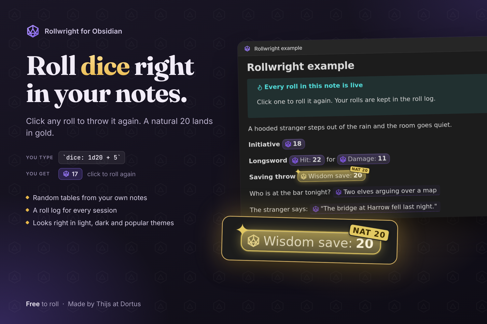
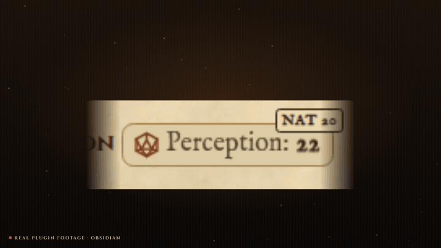
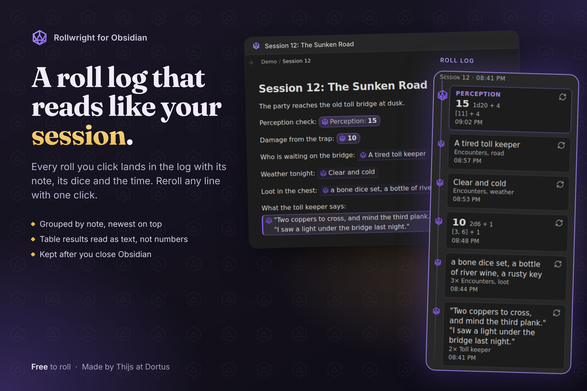

# Rollwright

**Roll dice right in your notes.** Write `` `dice: 1d20 + 5` ``, read the result, click to roll again. A natural 20 lands in gold.



Made by Thijs at [Dortus](https://dortus.com) for game masters and solo players who keep their sessions in Obsidian. It uses the `dice:` notation known from the Dice Roller plugin.



## What you can do

- **Roll dice in a sentence.** `` `dice: 1d20 + 4` `` becomes a result you can click to roll again. Supports keep highest, exploding, rerolls, success counting, Fudge and narrative dice.
- **Roll on your own notes.** Pick a random row from a table, an item from a list, a block from a note, a line, or a note with a tag.
- **Lookup tables.** Put a formula in the first header and Rollwright picks the matching row. Cells can hold rolls too.
- **Keep or write a result.** `dice+:` keeps a result after a restart, `dice-mod:` writes it into the note after you confirm.
- **Roll log.** A side panel shows what you rolled, grouped by note and session, and lets you roll again.
- **Works where you write.** Reading view and Live Preview look the same, in light and dark themes.



## Quick start

1. Install Rollwright from Community plugins and turn it on.
2. In any note, type `` `dice: 2d6 + 3` `` (with the backticks).
3. Switch to reading view or move the cursor away. Click the result to roll again.

For a table, give it a block id such as `^loot` and write `` `dice: [[Treasure^loot]]` ``.

All rolling is free. Optional skins are a one-time purchase (see [Paid skins](#paid-skins)).

## Full reference

Everything below is detail for when you need it. Rollwright is at version 0.3.0. Before each release, automated tests run it in the real Obsidian app, in reading view and Live Preview.

### Rolling dice

Write `` `dice: 2d6 + 3` `` in a note. It works in reading view and Live Preview. Hover to see the formula and the dice. Click to roll again. A result stays while you scroll or type elsewhere in the note. It is rolled again when you click, after a restart, and when lines above it are added or removed, because a result is tied to its line. A roll in a table cell can also roll again when the note is drawn again.

#### Keep a result

To keep a result after a restart, write `` `dice+: 2d6` ``. Rollwright saves it in its own plugin data, for that note and that place in it. A click rolls again and keeps the new result. Up to 500 kept results are saved; beyond that the oldest is dropped. `` `dice-: 2d6` `` never keeps a result and works like `dice:`. When Rollwright cannot tell which line a code is on, as can happen in a table cell of the note itself, `dice+:` works like `dice:` and keeps nothing. Inside a cell of a table you roll on, or as a lookup table header, `dice+:` and `dice-:` roll like `dice:`: the result is kept, or not, as part of the outer roll. Inside such a cell or header, `dice-mod:` is not rolled and stays as text.

#### Write a result into the note

To write a roll into the note for good, use `` `dice-mod: 3d100 + 12` ``. It shows a roll like `dice:`. A click, or Enter, does not roll again: it asks first and shows the text that goes in. Replace turns the code, backticks included, into the result you see, as in `3d100 + 12 -> [75, 20, 75] + 12 -> 182`. A setting leaves out the formula: `[75, 20, 75] + 12 -> 182`. The total follows the number flags; labels such as `|text(x)` are not written. A roll on a table, list, note or tag writes only its result, on one line, and that other note is never changed. Characters that would change the line get a backslash, such as a backtick, a `|` in a table row, or a `#` or `-` at the start of a line. Rollwright only writes into the note that holds the code. It refuses inside an embedded note and when it cannot tell which line the code is on, as can happen in a table cell; then it says so and changes nothing. In Live Preview, undo takes the change back. In reading view the file is changed directly, and undo may not take that back, so check the window before you choose Replace.

#### Clicks with Ctrl or Alt

Ctrl-click (Cmd-click on a Mac) on a result from a table, list, section, line or tag opens the note it came from, in a new tab, without rolling. A tag roll over several notes has no single note to open, so it only says so. On a dice roll, Ctrl-click rolls again like a plain click. Alt-click (Option-click on a Mac) on a dice roll shows its average, as `|avg` does; it is not added to the roll log. Ctrl-click on a code with `|none` hides its result again and forgets it, also for `dice+:`. On `dice-mod:`, Ctrl-click opens the source of a table or section result; any other click opens the replace window. Phones have no Ctrl or Alt key, so there only a plain tap works.

#### Dice notation

| You write | What it does |
|---|---|
| `2d6 + 3 * (1d4 - 1) ^ 2` | Arithmetic with `+ - * / ^` and brackets |
| `d20`, `3d`, `d` | Leave out the count (1) or the sides (100). Both can be changed in the settings |
| `2d[3,5]` | Dice from 3 to 5, both included |
| `1d[1,3,5]` | Dice with exactly these faces |
| `d%` | A hundred-sided die |
| `1d66%` | One die per digit, read together: 6 and 3 give 63 |
| `4dF` | Fudge dice |
| `1dS` | Fantasy AGE stunt die: three six-sided dice, the third is the stunt die (`S:`). The result is their sum. On a double, the stunt die gives that many stunt points, shown in the tooltip. Only one stunt die per `1dS`; `2dS` is an error |
| `(1d4)d6` | Roll for the number of dice first |
| `3g2d`, `2y1c1b`, `1w` | Narrative dice of Genesys and the Star Wars roleplaying games: Ability `g`/`a`, Proficiency `y`/`pro`, Difficulty `d`/`diff`, Challenge `r`/`c`, Boost `b`/`boo`, Setback `s`/`sb`/`blk`, Force `w`/`f`, capitals the same. `p` is Proficiency when the roll also has an `a`, `c` or `d` die, otherwise it asks you to write `y` or `d`. Success cancels Failure and Advantage cancels Threat; Triumph also counts as a Success and Despair as a Failure. The result reads like `2 Success, 1 Threat`, the tooltip shows each die. Only when the whole formula is narrative dice and cannot be read as ordinary dice: `2d`, `d`, `4dF` and `1D6KH1` stay ordinary dice, as do saved formulas and note fields such as `gp`. No average with `\|avg` |

#### Modifiers

Modifiers run from left to right. A number is optional and defaults to 1.

| Modifier | Meaning | Shown as |
|---|---|---|
| `k2`, `kh2` | Keep the highest 2 | `3d` for a dropped 3 |
| `kl2` | Keep the lowest 2 | `3d` |
| `dl2`, `dh2` | Drop the lowest or highest 2 | `3d` |
| `!2`, `!i` | Explode up to 2 times per die. `i` means up to 100 | `6!` |
| `!!2`, `!!i` | The same, added into a single die | `28!` |
| `r2`, `ri` | Reroll up to 2 times and replace. `i` means up to 100 | `4r` |
| `s`, `sa`, `sd` | Sort low to high, or high to low | |
| `u` | Reroll until all dice differ | `4r` |

`!` explodes on the highest face and `r` rerolls the lowest, unless you add conditions: `1d4!=3`, `1d4!i=!3`, `1d4r<3`, `1d4r<2>3`. Conditions right after `!` or `r` belong to that modifier.

#### Counting successes

A condition on dice turns each die into a score: 1 if it matches, otherwise 0. The result is the sum.

`=`, `=!` (not equal), `>`, `<`, `>=`, `<=`, and `-=` or `=-` to score -1. Example: `5d10>=8-=1`. The first matching condition counts. The threshold can be dice too: `3d6>1d6`.

#### Flags

Add flags after `|`, as in `1d20 + 2|nodice|text(Dexterity +2)`.

| Flag | Effect |
|---|---|
| `\|nodice` | Hide the die icon |
| `\|form` | Show the formula before the result |
| `\|avg` | Show the average first; a click rolls. With modifiers, or when a formula divides by dice or raises dice to a power, the average is an estimate, marked with `~` |
| `\|none` | Show only an icon until the first click |
| `\|text(label)` | Show your label before the result |
| `\|round` | Round a dice result to the nearest whole number (2.5 becomes 3, -2.5 becomes -3). Off unless you add it, so `10 / 4` shows 2.5 |
| `\|ceil` | Round a dice result up (1.25 becomes 2) |
| `\|floor` | Round a dice result down (1.75 becomes 1) |
| `\|noround` | Turn rounding off again |
| `\|signed` | Always show a sign: `+3`, `-2`, `+0` |
| `\|paren` | Put the result between brackets: `(6)`, with `\|signed` `(+3)` |
| `\|noparen` | Turn the brackets off again |

The number flags only change dice results, not picks from tables, lists or notes, and only what is shown: the tooltip still shows the exact roll. When two of them clash, the last one counts, so `|round|noround` does not round. A table column with the same name as a flag, such as Round, still wins.

### Rolling on your notes

| You write | What it does |
|---|---|
| `[[Note^id]]` | A random row of that table, or a random item of that list |
| `3[[Note^id]]`, `3d[[Note^id]]`, `1d4+1[[Note^id]]` | Several picks. Picks can repeat |
| `[[Note^id]]\|Column` | A random cell from that column |
| `[[Note^id]]\|xy` | A random cell, outside the first column. A column named xy wins |
| `[[Note]]` | A random block of the note, without frontmatter and horizontal rules |
| `[[Note]]\|paragraph,heading-2` | Only these block types |
| `[[Note]]\|line` | A random non-empty line |
| `#tag`, `#tag\|+` | A random block from each note with the tag |
| `#tag\|-` | A random block from one random note with the tag |
| `#tag\|link` | A link to one random note with the tag |
| `2d#tag`, `#tag\|-\|paragraph,yaml` | Several picks, and block types |

The forms `[[Note#^id]]` and `[text](Note#^id)` also work. For a table in the same note, write `[[#^id]]`; that keeps working when you rename the note.

A roll inside a block or section you draw is not rolled again: it shows as plain code. An embedded note in such a result becomes a link. Embedded images stay.

#### Lookup tables

If the first header is a formula, Rollwright rolls it and finds the matching row. Rows can be written as `1-2`, `11`, `13,14` or `51–60`. A cell may hold another roll, such as `` `dice: 2d6` `` or `dice: [[Note^id]]`.

```markdown
| dice: 1d20 | Weather |
|---|---|
| 1-5 | Rain |
| 6,7 | Fog |
| 8–20 | `dice: [[Skies^clear]]` |
^weather
```

### Side panel, commands and settings

- **Roll log** shows rolls you clicked or typed, grouped under the note and the time the session began, and lets you roll again. Rolls that happen by themselves when a note opens are not listed. The log is stored in the plugin's data file.
- **Commands:** "Open roll log" and "Roll a formula".
- **Settings:** default die, default number of dice, whether `dice-mod:` keeps the formula, and saved formulas. A saved formula works by name in any roll, such as `` `dice: attack` `` or `1d6 + bonus`. A number in the frontmatter of the note works the same way: with `str: 3` in the note, `` `dice: 1d20 + str` `` adds 3. A saved formula with the same name goes first. Only the note's own frontmatter counts, also for a code inside a table or section drawn from another note; inline fields such as `str:: 3` and text that is not a number do not. Names that read as dice notation, such as `d`, `dh`, `k`, `s` or `F`, stay notation.
- **Import:** a button copies named formulas from the data file of the Dice Roller plugin, if you have it. That file is only read. Existing names are kept. The layout of that file was not verified, so an import may find nothing.

## Paid skins

**All rolling features are free. Two visual skins, Parchment and Arcane, are paid and need a license key.** The Classic skin is free.

You buy the skins once through Polar: press Buy for $6 in the settings, pay, then paste the license key from your Polar purchases in the settings and press Activate. One key works on all your devices.

## Payments and network

The paid skins are sold through [Polar](https://polar.sh). You need no account with Rollwright. The plugin only goes online to check your license key, at `api.polar.sh`: when you press Activate, and after that quietly at most once every 30 days. It sends your key, our organization id and our benefit id, nothing else. Polar sees your IP address. The plugin keeps only the key and the date of the last check; the name and e-mail that Polar sends back are not stored and not logged. If Polar cannot be reached, a key that is already active stays active. Read Polar's [privacy policy](https://polar.sh/legal/privacy).

## Privacy

Rollwright has no telemetry and needs no account. Its only network connection is the license check described above, and only once you use a license key. It reads your notes to roll on them. Your notes are only changed when you confirm a `dice-mod:` code, and then only that code in that note. Outside the vault it touches nothing.

## Limits

Up to 1000 dice per group, 10000 dice per formula, 1000000 sides, and 100 repeats per die for `!` and `r`. One roll, nesting included, can use up to 10000 picks from notes. Beyond that you get a message. A broken formula is underlined and the tooltip gives the reason.

## Support

Questions, ideas or a bug? Open an issue on [GitHub](https://github.com/thijsduinhouwer2002-coder/rollwright/issues) or write to thijs@dortus.com.

## Development

`npm install`, then `npm test`, `npm run build` and `npm run lint`.

## License

MIT, see [LICENSE](LICENSE).
